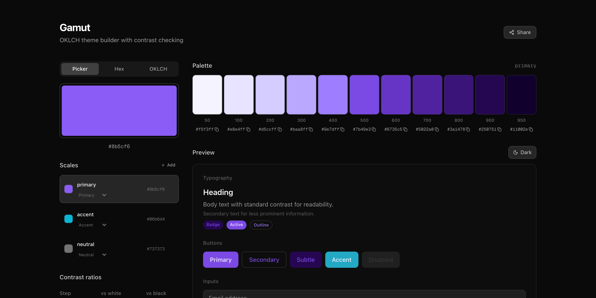

# Gamut

Real-time theme builder powered by OKLCH colour science.



## Features

- **Multiple colour scales** — build a full theme with primary, secondary, accent, and neutral scales side by side
- **OKLCH colour picker** with hex input, native picker, and L/C/H sliders
- **11-step palette generation** — lightness and chroma curves derived in OKLCH space, with automatic sRGB gamut clamping
- **Semantic token mapping** — 13 tokens (background, surface, text, border, primary, accent) auto-mapped from scale roles for light and dark modes
- **WCAG contrast grid** — contrast ratios against white and black with AA/AAA badges for every step
- **Live preview** — buttons, cards, inputs, typography, and badges update in real time using semantic tokens
- **Light/dark mode toggle** — flips semantic token mappings so you can preview both modes instantly
- **Export** — CSS custom properties, Tailwind config, JSON tokens, or Style Dictionary format with one-click copy
- **Shareable URLs** — full theme state (all scales, roles, mode) encoded in the URL

## Colour science

All colour math is implemented from scratch with zero dependencies:

- OKLCH to sRGB conversion via OKLab intermediate (Bjorn Ottosson's matrices)
- Gamut clamping via binary search on chroma
- WCAG 2.1 relative luminance and contrast ratio calculation
- Perceptually uniform lightness distribution across 11 steps

## Tech stack

Next.js, TypeScript, Tailwind CSS

## Getting started

```bash
npm install
npm run dev
```

## Licence

MIT

## Editing and export integrity

Scale IDs stay fixed when names change. Semantic preview and export colours follow those IDs. Export keys are normalised and made unique, so duplicate display labels remain separate scales. New shared URLs retain IDs, editable names and active selection; older links remain readable. Invalid shared colours are rejected before palette generation.

`npm test` covers rename/export and shared-state regressions. `npm run test:icons`, `npm run lint`, `npm run typecheck` and `npm run build` provide the local release checks. Tests use Node 24's native TypeScript support. See [the verification record](docs/quality/gamut-verification-20261120.md) for evidence and limitations.
